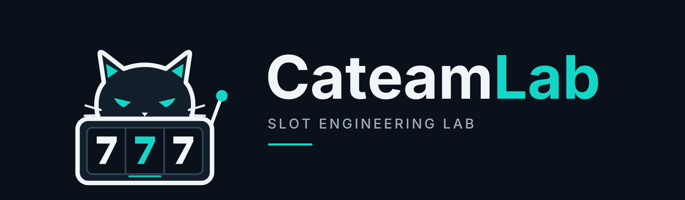

  

  
<strong>Game Mathematics &nbsp;·&nbsp; Slot Engines &nbsp;·&nbsp; Developer Tools</strong>

  
Разработка программных технологий для слот-игр и игровой инфраструктуры.

---

### About CateamLab

**CateamLab** — независимая инженерная команда, специализирующаяся на программных технологиях для разработки слот-игр. Мы проектируем математические модели, расширяемые игровые движки и инструменты, которые помогают создавать, анализировать и интегрировать игровые механики.

Наша работа сосредоточена на точности расчётов, воспроизводимости игровых результатов, ясных API-контрактах и повторном использовании компонентов между разными игровыми проектами.

### Areas of expertise

| Направление | Что разрабатываем |
|:--|:--|
| **Game Mathematics** | RTP, вероятностные модели, расчёт выигрышей и бонусная математика |
| **Slot Engine SDK** | Переиспользуемое Python-ядро, игровые состояния, evaluators и bonus systems |
| **Simulation & Validation** | Monte Carlo, exact-модели, калибровка, статистические проверки и отчёты |
| **Game Integration** | Событийные контракты, воспроизведение раундов, тестовые стенды и инструменты разработчика |

### Engineering principles

**Mathematical correctness.** Проверяемые расчёты, зафиксированные параметры и воспроизводимые эталоны.

**Extensible architecture.** Изолированное ядро и явные интерфейсы расширений для новых механик.

**Reliable integration.** Детерминированное воспроизведение, целочисленные выплаты, состояния и транзакционные границы.

**Developer experience.** Документация, CLI, практические примеры и приватные дистрибутивы SDK.

---

  Основные программные продукты разрабатываются в приватных репозиториях. Публичные материалы публикуются по мере готовности.

